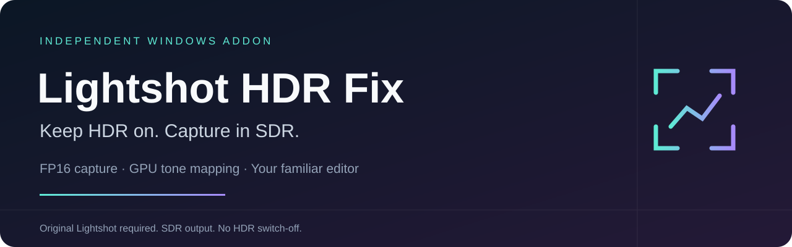
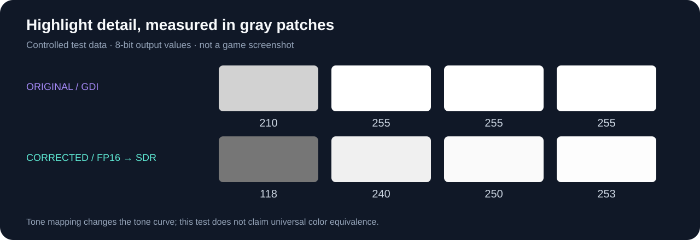

# Lightshot HDR Fix

[English](../../README.md) · [Português (Brasil)](pt-BR.md) · [Español](es.md) · [Français](fr.md) · [Deutsch](de.md) · [简体中文](zh-CN.md) · [日本語](ja.md)

**HDR eingeschaltet lassen. In SDR aufnehmen.** Unabhängiges Addon gegen ausgewaschene oder überbelichtete Lightshot-Aufnahmen: FP16-Erfassung und GPU-Tonemapping liefern ein SDR-Bild an den gewohnten Editor, ohne gelben Windows-Graphics-Capture-Rahmen.

[**Windows-Installer herunterladen**](https://github.com/Joaovitorsw/lightshot-hdr-fix/releases/latest/download/Lightshot-HDR-Fix-Setup.exe) · [Versionen](https://github.com/Joaovitorsw/lightshot-hdr-fix/releases) · [Validierung](../VALIDATION.md)

## Installation

1. Installiere zuerst das [kompatible Original-Lightshot](https://app.prntscr.com/en/).
2. Lade **Lightshot-HDR-Fix-Setup.exe** herunter und starte es. Python und Administratorrechte sind nicht erforderlich.
3. Das Setup erkennt eine kompatible Installation. Wird keine gefunden, wähle den Versionsordner. Läuft Lightshot noch, fragt das Setup vor dem Schließen nach.
4. Öffne anschließend **Lightshot HDR Fix** im Startmenü. Desktop-Verknüpfung und Start nach der Installation sind optional.

Installer **0.3.0** kopiert Lightshot in einen lokalen Ordner deines Benutzerkontos und verändert **nur die Kopie**. Das Original bleibt erhalten; der Windows-Autostart wird nicht automatisch geändert. Zum Zurückwechseln die Kopie schließen und das Original starten. Nur eine Instanz verwenden: Tastenkürzel, Einstellungen und Mutex können gemeinsam genutzt werden.

> Installer und Addon sind nicht signiert. SmartScreen kann eine Warnung anzeigen; prüfe, dass der Download aus den Releases dieses Repositorys stammt.

## Kompatibilität und Grenzen

Windows 10/11 und DXGI-1.5-fähige Grafik. Erfordert Lightshot x86 im Ordner **5.5.0.7**, EXE-Versionsressource **5.5.0.4** und exakte Datei-Hashes. Andere Versionen werden abgelehnt. **Original-Lightshot ist nicht enthalten.** SDR-Ausgabe bei weiterhin aktiviertem HDR.

Exklusives Vollbild, geschützte Inhalte, gedrehte Bildschirme und der vollständige Ablauf für Bearbeiten/Speichern/Zwischenablage benötigen weitere Tests. Der GDI-Fallback kann bei Fehlern überbelichtet bleiben. Cursor können doppelt erscheinen.

## Kontrollierter Vergleich

Kontrollierte Graufelder, **kein Spiel-Screenshot**: Originalausgabe **210 / 255 / 255 / 255**, korrigiert **118 / 240 / 250 / 253**. Die Tonkurve ändert sich, damit helle Bereiche unterscheidbar bleiben; keine universelle Farbgleichheit.

Auf einem einzelnen RTX-5080-System (3440×1440 HDR + 1920×1080 SDR): vollständige Kernaufnahmen in **62–78 ms** im warmen Zustand, etwa **312 ms** beim ersten Aufruf. Keine Garantie für die Gesamtlatenz. [Ergebnisse und Grenzen](../VALIDATION.md).

## Manuelles ZIP und Build

Das ZIP ist eine erweiterte Alternative mit Python 3.10+. [Befehle, Hashes und technische Details stehen im englischen README](../../README.md#manual-zip-installation).

Unabhängig von Skillbrains, keine Neukompilierung des geschlossenen Lightshot-Kerns. Für den neuen Code wurde keine allgemeine Open-Source-Lizenz gewählt; Drittanbieter-Komponenten behalten ihre Lizenzen.
